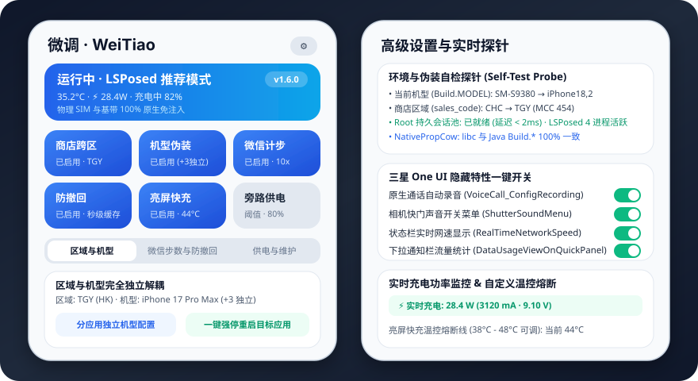
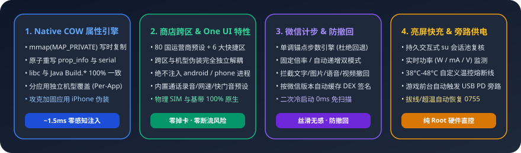

# 微调 (WeiTiao)

[English](README.en.md) · **[点击直接下载安装包 (WeiTiao-v1.5.3.apk · 1.6 MB)](https://github.com/WEIHEWU/WeiTiao/raw/main/releases/WeiTiao-v1.5.3.apk)** · [Releases 页面](https://github.com/WEIHEWU/WeiTiao/releases)

一个基于 `libxposed API 102`、`Root` 与 **`miuix` (`0.8.8`)** 界面的三星 One UI 增强模块，集成 **底层 Native COW 系统属性伪装引擎**、**应用商店跨区解锁（CSC/SIM 伪装）**、**分应用独立硬件机型伪装（三年内纯血旗舰库）**、**三星 One UI 隐藏 CscFeature 一键预设**、**微信运动步数与消息防撤回**、**亮屏快充（实时功率监控）** 以及 **USB PD 应用旁路供电**。

> 全面测试并官方适配三星 One UI 8.5 / One UI 9（Android 17 / API 37），兼容搭载 One UI 的 Galaxy 全系机型。

<p align="center">
  
</p>

<p align="center">
  
</p>

## 核心特性

- **Miuix 原生质感与 3×2 一屏控制中心**：
  - 基于 `top.yukonga.miuix.kmp:miuix:0.8.8` 全面构建，支持可折叠大标题导航栏、物理弹性越界回弹 (`overScrollVertical`)、G2 连续曲率圆角 (`smoothRounding`) 与 `folmeSpring` 物理弹簧弹窗动画；
  - 顶部状态大卡实时融合运行环境、电池温度、实时充电功率（`W`）与电量状态；下方 3×2 快捷磁贴与三段式配置面板联动，一屏直达全部核心参数，未满足前置条件（未激活 LSPosed 或未授予 Root）时自动弹出精准引导提示。
- **底层 Native COW 系统属性改写引擎 (`NativePropCow`)**：
  - 彻底攻克 iPhone/Apple 及全品牌机型在加固防篡改应用（如腾讯乐固/加固、酷安、QQ 等）中失效的行业难题；
  - 精准解析进程 `/proc/self/maps`，通过 `mmap(MAP_PRIVATE | MAP_FIXED)` 将 `/dev/__properties__/*` 共享内存页转换为私有写时复制（COW）物理页，并利用直接内存指针及原子 `serial` 计数重写底层属性；
  - 彻底消除 Native libc（`__system_property_get`）与 Java 层（`Build.*`）不一致引起的防篡改回退，毫秒级注入（`~1.5ms`）且 100% 稳定。
- **跨区伪装与机型伪装完全独立解耦 + 分应用独立机型伪装 (Per-App Model Spoofing)**：
  - **完全独立解耦**：「商店跨区 (`enabled`)」与「机型伪装 (`spoofDevice`)」、「自定义 `CscFeature` / `SystemProperties`」完全独立运行，无需开启商店跨区即可单独使用机型伪装或 One UI 隐藏特性；
  - **分应用独立机型**：支持全局默认伪装机型的同时，可在「机型伪装生效应用」列表中点击任意已勾选应用的机型徽章，**为不同应用单独指定专属机型**（例如：《王者荣耀》伪装 ROG 9 Pro 解锁极高帧率、酷安伪装 iPhone 17 Pro Max、微博伪装 Mate XT 三折叠）；
  - **自动同步作用域与一键强停生效**：保存生效应用或切换机型时，自动通过 Root 同步 LSPosed SQLite 作用域（或调用 Xposed API 102 `requestScope`）并自动强制停止目标应用进程，确保重开应用 100% 立即生效。
- **应用商店跨区解锁（CSC + SIM 联合伪装）**：
  - 内置 6 大精选预设（中国香港 `TGY`、美国公开版 `XAA`、欧洲通用版 `EUX`、中国台湾 `BRI`、韩国官方版 `KOO`、中国大陆 `CHC`）及全球 80 个国家/运营商预设检索库；
  - 仅对应用商店（Galaxy Store / 主题商店 / 三星账号判区组件）返回目标 CSC 与 SIM 运营商信息，**绝不注入系统框架 (`android`) 或电话服务 (`com.android.phone`)，确保物理 SIM 卡与系统基带 100% 原生稳定**；
  - 支持一键清理商店缓存并立即切换区域，支持随时关闭跨区伪装恢复物理 SIM 原生识别（不影响机型伪装）。
- **三星 One UI 隐藏 `CscFeature` 一键预设 & 环境自检探针**：
  - 设置页内置常用 One UI 隐藏特性一键开关：**原生通话自动录音**、**相机快门声音开关菜单**、**状态栏实时网速显示**、**下拉通知栏流量统计**，并提供可视化 Key-Value 快捷添加栏与 JSON 格式化编辑器；
  - 内置 **环境与伪装自检探针 (Self-Test Probe)**，一键检测当前生效 `Build.MODEL`、`ro.csc.sales_code`、Root 持久会话状态与 LSPosed 活跃注入进程数。
- **微信增强（步数倍增 + 秒级缓存消息防撤回）**：
  - **微信运动步数修改**：基于单调递增绝对锚点偏移模型，支持自动递增与固定倍率模式、4 档快捷倍率切换、实时步数换算预览、每日封顶上限与截止时间，跨天与重启平滑衔接，杜绝负跳变；
  - **微信消息防撤回（版本级 DEX 缓存）**：拦截对方撤回指令并展示防撤回提示，保留文字、图片、语音及视频文件；按微信 `versionCode + lastUpdateTime` 自动缓存 DEX 方法签名，二次冷启动 **0ms 免扫描直接挂载**。
- **亮屏快充 & USB PD 应用旁路供电（持久交互式 Root 会话池，无需 LSPosed）**：
  - **持久 `su` 会话复用**：`RootShell` 采用持久交互式 `su` 管道会话（异常时自动无缝回退单次执行），大幅降低周期温控与旁路轮询的 CPU 与进程创建开销；
  - **实时充电功率遥测与自定义温控熔断**：充电时在主面板与通知栏实时显示充电功率 `W`、电流 `mA`、电压 `V`；支持在 `38°C–48°C` 范围内自定义亮屏快充安全温控熔断阈值（默认 `44°C`），达到阈值或拔线时立即恢复 `0755` 原厂温控；
  - **USB PD 应用旁路供电**：前台运行指定游戏/应用且电量达到设定阈值时，自动开启旁路供电直接给主板供电，大幅降低边充边玩发热。

## 推荐 LSPosed 作用域

启用模块后，LSPosed 会自动勾选以下推荐作用域（**请勿勾选 `android` 系统框架或系统设置**）：

- `com.sec.android.app.samsungapps`（三星应用商店 Galaxy Store）
- `com.samsung.android.themestore` / `com.samsung.android.themecenter`（三星主题商店）
- `com.osp.app.signin` / `com.samsung.android.samsungaccount` / `com.samsung.android.authfw`（三星账号判区服务）
- `com.tencent.mm`（微信）
- 以及你在「机型伪装生效应用」中添加的目标应用（具备 Root 时保存会自动同步至 LSPosed 作用域）

> **注意**：「亮屏快充」与「应用旁路供电」通过 Root 直接控制硬件节点，**不需要**勾选任何 LSPosed 作用域，但建议将「微调」设为系统电池优化「不受限制」以防后台服务被深度休眠拦截。

## 验证与常见问题排查 (Troubleshooting)

1. **如何确认伪装或 LSPosed 注入已经生效？**
   - 打开「微调」右上角 **设置 → 环境与伪装自检探针**，可实时查看当前生效的 `Build.MODEL`、`ro.csc.sales_code`、Root 授权状态以及已上报心跳的活跃宿主进程列表。
2. **为什么修改了伪装机型后，目标 App 内显示的还是旧机型？**
   - Android 应用通常在进程冷启动时缓存 `android.os.Build` 与底层属性。在微调中选择机型或保存生效应用时，若已授予 Root 权限会自动强停目标应用；你也可以随时点击「区域与机型」面板中的 **「一键重启伪装目标应用」** 立即刷新所有目标进程。
3. **关闭「商店跨区」会影响我的「机型伪装」吗？**
   - **不会**。自 v1.5.0 起，商店区域伪装与硬件机型伪装、自定义 `CscFeature` 已彻底解耦，可完全独立开关。

## 构建

需要 JDK 17+ 与 Android SDK（`compileSdk 37`）。

```bash
./gradlew testDebugUnitTest assembleRelease
```

APK 输出在 `app/build/outputs/apk/release/app-release.apk`。
签名从 `local.properties` 读取（`signing.storeFile` 等字段），未配置时自动回退到 `~/.android/debug.keystore`，克隆仓库后可直接构建；GitHub Actions Release 工作流会自动编译 Release APK 并附带 `.sha256` 校验文件。

## 免责声明

本模块仅用于个人学习与研究。修改系统属性或温控节点可能带来潜在风险，请自行评估并承担相应后果。

## License

GNU General Public License v3.0 (GPL-3.0-only)。详见 [LICENSE](LICENSE)。
扩展机型模板来源及许可见 [THIRD_PARTY_NOTICES.md](THIRD_PARTY_NOTICES.md)。
